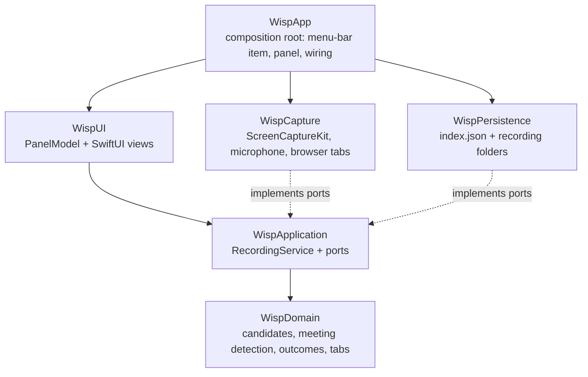

# Architecture

Wisp keeps the rules about recording (what can be recorded, what counts as a finished
recording, which audio goes with which video) in plain Swift, away from macOS APIs.
ScreenCaptureKit, AVFoundation, the browsers' scripting interfaces, the file system and the UI
sit around that core and talk to it through a few protocols ("ports"). The app's `main.swift`
wires the pieces together.



Dependencies point inwards. `WispDomain` depends on nothing but Foundation.

## Modules

| Module | Holds | Must not |
| --- | --- | --- |
| `WispDomain` | `Meeting`, the three tracks, `MeetingOutcome`, `RecordingPhase`; which windows are recordable and in what order (`CaptureCandidates`); meeting detection (`MeetingDetector`); the two sources offered up front (`RecordChoices`); the default audio source (`AudioSourcePolicy`); browser-tab matching and following (`BrowserTabs`, `TabFollow`) | Import anything but Foundation |
| `WispApplication` | `RecordingService` (an actor: start, stop, list, rename, delete, crash recovery) and the ports in `Ports.swift` | Expose ScreenCaptureKit types |
| `WispCapture` | ScreenCaptureKit listing, thumbnails and the recording pipeline; the microphone track and the Room pipeline; window frames and titles (CoreGraphics); the browser-tab reader | Re-implement domain rules |
| `WispPersistence` | `FileMeetingRepository` (`index.json`) and `LocalMeetingFileStore` (folders under `~/Movies/Wisp-macos`) | |
| `WispUI` | `PanelModel`, the views for each panel state, design tokens, permission checks | Talk to ScreenCaptureKit |
| `WispApp` | `main.swift`: the status item, the borderless panel, keyboard handling, the recording frame | Hold business rules |

Two tools are built with the package: `capture-smoke` (contract tests against the real
ScreenCaptureKit, see [CONTRIBUTING.md](CONTRIBUTING.md)) and `panel-snapshots` (renders every
panel state offscreen to PNG).

ScreenCaptureKit types never leave `WispCapture`: the adapter turns `SCWindow` and `SCDisplay`
into the domain's `CaptureSource` before returning them, and ids are opaque strings
(`window:<id>`, `screen:<id>`, `tab:<bundle id>:<tab key>`) that only `WispCapture` parses.
Ports may use CoreGraphics types (`CGImage`, `CGRect`); what is kept out is ScreenCaptureKit.

## Ports

| Port | Implemented by | Used for |
| --- | --- | --- |
| `CaptureSourceListing` | `SCKCaptureSourceListing` | Windows and displays, with the facts `CaptureCandidates` needs |
| `CaptureThumbnailProvider` | `SCKThumbnailProvider` | Picker thumbnails and the live preview |
| `CaptureTargetLocating` | `CGTargetLocator` | Where the recorded window is, for the on-screen frame |
| `CapturePipeline` | `SCKCapturePipeline` | Meeting recordings: `video.mov`, `mic.m4a`, `system.m4a` |
| `AmbientMicPipeline` | `MicOnlyAmbientPipeline` | Room recordings: `mic.m4a` |
| `MeetingRepository` | `FileMeetingRepository` | The list of recordings |
| `MeetingFileStore` | `LocalMeetingFileStore` | Where each recording's folder lives |
| `BrowserTabReading` | `AppleScriptBrowserTabs` | Browsers' windows and tabs (see [Browser tabs](#browser-tabs)) |
| `WindowTitleReading` | `CGTargetLocator` | A cheap way to notice that a browser window changed tab |

Ports exist where a second implementation is real today: the fakes in the tests. There are
no ports for transcription or cloud storage; they will be added when that work starts.

## A meeting recording, end to end

```swift
let candidates = try await recording.listCaptureCandidates()   // filtered and ordered by the domain
let choices = RecordChoices.make(candidates: candidates, pinned: nil)        // windows, screens and tabs
let audio = AudioSourcePolicy.automatic(inCallMeeting: choices?.inCallMeeting)
let id = try await recording.start(video: choices!.primary.id, audio: audio, title: "Zoom Meeting")
// … later
let result = try await recording.stop()
```

1. **Listing.** `SCKCaptureSourceListing` asks ScreenCaptureKit for every window, including
   off-screen ones (`onScreenWindowsOnly: false`), so meeting windows on another Space (desktop)
   are listed with their titles; with `true` they are not. `CaptureCandidates` then keeps real
   work windows only: normal window layer, owned by a regular app, at least 160 × 100 points,
   not untitled-and-off-screen, not Wisp itself (about 170 windows become about 13). Order: the
   meeting in a call, other meeting windows, on-screen windows front to back, then the rest.
2. **Choosing.** `RecordChoices` offers two sources: in a call, the meeting window and the main
   display; otherwise the main display and the frontmost window. `MeetingDetector` recognises
   Zoom, Teams, Meet and Webex from bundle ids and window titles (and tabs from their address),
   on the Mac only.
3. **Audio.** `AudioSourcePolicy` picks the in-call meeting app for `system.m4a`, or every app
   when there is no call or the meeting runs in a browser (browsers play audio from helper
   processes that ScreenCaptureKit does not list separately). The user can override it.
4. **Recording.** `RecordingService.start` creates the folder, inserts a row with status
   `recording`, and starts the pipeline. `SCKCapturePipeline` runs two `SCStream`s: one for
   video (the window via `desktopIndependentWindow`, or the display without Wisp's own
   windows) and one for audio (the chosen app, or every app except Wisp). ScreenCaptureKit
   filters sound per app, never per window, which is why video and audio are separate streams.
   The microphone comes from an `AVCaptureSession` (`MicrophoneTrack`). All three tracks go
   through the same `TrackWriter`: they share one host-clock start time, the audio tracks are
   padded with silence until their first sample, and every track ends at the same stop time,
   so the three files line up (within a few hundredths of a second in `capture-smoke`).
   Files are written in 10-second fragments, so a crash or power loss keeps everything up to
   the last fragment instead of losing the files.
5. **Stopping.** `stop()` finishes the files and asks the domain for the outcome:
   `MeetingOutcome` says a meeting recording is complete when any track has data (a meeting
   without video still has the sound a transcript needs; the panel says the video is empty),
   and a Room recording when `mic.m4a` has data. A second stop is refused with `notRecording`;
   ScreenCaptureKit's "already stopped" error is
   ignored.

Room recordings use `startRoom()` and `AmbientMicPipeline` instead, and live under
`ambient/` ([docs/ambient-mode.md](docs/ambient-mode.md)).

### Lifecycle and failure

- `RecordingPhase` (`idle`, `starting`, `recording`, `stopping`, `failed`) cannot represent
  "idle with a recording id". `RecordingService` is an actor and checks the phase before every
  transition, so two starts cannot overlap. One recording runs at a time, Meeting or Room.
- Quitting Wisp while recording (menu, ⌘Q, logging out) stops the recording first, so the files
  are finished. Killing the process does not get that chance; `Scripts/package-app.sh`
  therefore never kills Wisp.
- At launch, `reconcileInterruptedMeetings()` settles rows still marked `recording` (the app
  crashed or was killed): `interrupted` when any track has data (playable up to the last
  fragment), `failed` when none has.
- A writer that refuses samples (disk full, encoder error) stops taking them; at stop its file
  is kept only if it plays, otherwise the stop fails instead of reporting a finished recording.

## Storage

```
~/Movies/Wisp-macos/
  index.json            JSON array of Meeting rows (id, title, status, times, mode)
  <id>/                 video.mov, mic.m4a, system.m4a
  ambient/<id>/         mic.m4a
```

A JSON index is enough at this size and easy to inspect; there is no database. A row this
build cannot read (for example a status written by a newer build) is kept and written back
untouched, and an index that is not JSON at all is moved aside (`index.unreadable-<time>.json`)
and rebuilt from the recording folders, so the list is never silently emptied.

## The panel

`PanelModel` (`@MainActor`, `ObservableObject`) is the panel's state machine. Its `surface` is
one of `permissions`, `ready`, `choosing`, `recording` or `detail`, and each has its own view.
The clock and the permission checks are injected, so the model is tested without a screen.
`main.swift` hosts the SwiftUI view in a borderless, non-activating `NSPanel` under the menu-bar
item and resizes it only when the content's size changes (not on every meter update).
`RecordingFrameController` draws the vermilion frame around the recorded window or display; it
is Wisp's own window with `sharingType = .none`, so it appears in neither Wisp's recording nor
other apps' screen sharing. The design tokens (palette, metrics, components) live in
`Sources/WispUI/Design`; the rules for using them are in [CONTRIBUTING.md](CONTRIBUTING.md).

## Browser tabs

ScreenCaptureKit knows windows, displays and apps, not tabs; a browser's own tab capture
(`getDisplayMedia`, extensions) works only inside the browser. So Wisp records **the window
that holds the tab, while the tab is the one showing**, and reads tabs through each browser's
scripting interface.

- **Domain.** A tab is a `CaptureSource` with `kind == .tab`, id `tab:<bundle id>:<tab key>`
  (`BrowserTabKey`) and `BrowserTabFacts` (address, whether it is showing, the window that
  holds it). `BrowserWindowMatcher` pairs each browser window with a recordable window: by
  frame, then by a unique title, then by front-to-back order; windows that cannot be told apart
  stay unmatched and their tabs are not offered. Private and incognito windows are skipped
  where the browser reports them (Chrome family, Arc; Safari and Dia do not).
  `TabFollow.state` says where a recorded tab is now: `showing(window:)`, `hidden(window:)` or
  `closed`. `MeetingDetector` recognises Meet, Zoom, Teams and Webex tabs from their address.
- **`BrowserTabReading`** lists supported running browsers with Wisp's Automation access
  (never prompting), asks for access (`requestAccess`, the only call that may show the macOS
  prompt), reads one browser's windows and tabs (`snapshot`, which must not launch a browser and
  must give up when cancelled), and brings a tab to the front of its window (`show`).
  `AppleScriptBrowserTabs` implements it for Chrome-family browsers (Chrome, Edge, Brave,
  Vivaldi, Chromium), Arc, Dia and Safari with JavaScript for Automation in an `osascript` child
  process: one Apple Event per property per window, a check that the browser is running, and a
  2-second timeout (then SIGTERM, then SIGKILL). Safari tabs have no id, so their key is the
  window id plus the tab's position: a page may change its address and stay followed, but a
  tab reordered or moved to another window is lost (the video then holds).
  Firefox has no tab scripting and is not supported.
- **`WindowTitleReading`** returns a window's current title, cheaply enough to poll. A browser
  window's title is the showing tab's title, so a change means "look at the tabs again".
- **`CapturePipeline.updateVideo(target:live:)`** points the running video at another window
  or display and pauses or resumes frames. Same target: only a frame gate opens or closes; the
  stream keeps running and the video holds its last frame, so timing and A/V alignment are
  unaffected. Another target: the stream's filter is swapped.
- **`RecordingService`.** `listCaptureCandidates(includingTabs:)` adds tabs from the browsers
  Wisp may read; browsers answer slowly, so the panel lists windows first and fills tabs in
  with a second call. `start` on a tab finds its window and, if the tab is hidden, shows it
  first; if it cannot, the pipeline starts with frames held. A **follower** task then runs
  for the whole recording: it polls the recorded window's title every 50 ms (a single-window
  CGWindowList read); when the title changes it holds frames at once and re-reads the browser
  (at most once a second). It also re-reads it every 10 seconds for changes a title does not
  reveal (a tab dragged into another window). A failed read is not taken as a closed tab; it
  is retried. Depending on `TabFollow.state` it calls `updateVideo` to resume, hold, or move
  to the tab's new window. `stop()` cancels the follower before stopping the pipeline.
- **Holding the right frame.** The switch to another tab is noticed a few frames late, so the
  other tab's frames can already be written. The video output keeps copies of recent frames
  (one every 150 ms, half a second's worth); when frames are held, the writer appends a copy
  from at least 250 ms before the switch was noticed, so the held picture is the recorded tab
  (`HoldFrameTests` checks this through the real encoder).
- **Audio** stays per app: ScreenCaptureKit cannot isolate one tab's sound, and a meeting in
  a tab records every app by default.

## Testing

Tests follow classical TDD: real objects where possible, fakes only at the ports.

| Area | How |
| --- | --- |
| Domain | Fast unit tests: candidate rules, ordering, labels, meeting detection, choices, outcomes, tab matching and following |
| Application | `RecordingService` with fake listing, pipeline and browser reader, and real temporary folders |
| Persistence | `FileMeetingRepository` on a temporary folder |
| UI | `PanelModel` with fake permissions and a fixed clock; `panel-snapshots` for the look |
| Capture adapters | Unit tests for id parsing, browser script output, the script runner's timeout and cancellation; `capture-smoke` against the real ScreenCaptureKit for alignment, retargeting, a late first frame and crash survival (needs permissions; not run in CI) |

## Decisions and the alternatives we rejected

- **One deep `RecordingService` with few ports**, rather than a port per repository method and
  a use-case class per file. Callers learn a handful of calls (list, start, stop, rename,
  delete); the rules stay in one place.
- **No ScreenCaptureKit in the UI layer**, so the panel is testable and the capture
  implementation can change without touching it.
- **Our own picker, not `SCContentSharingPicker`.** The system picker cannot pre-select the
  meeting in a call or show which app's sound will be recorded.
- **Two `SCStream`s, not a Core Audio process tap.** The tap is more precise but much more code;
  two streams reuse the existing capture and writers.
- **Swift Package Manager only**, no Xcode project; `Scripts/package-app.sh` builds the `.app`.
- **JSON, not SQLite**, for the recordings list.
