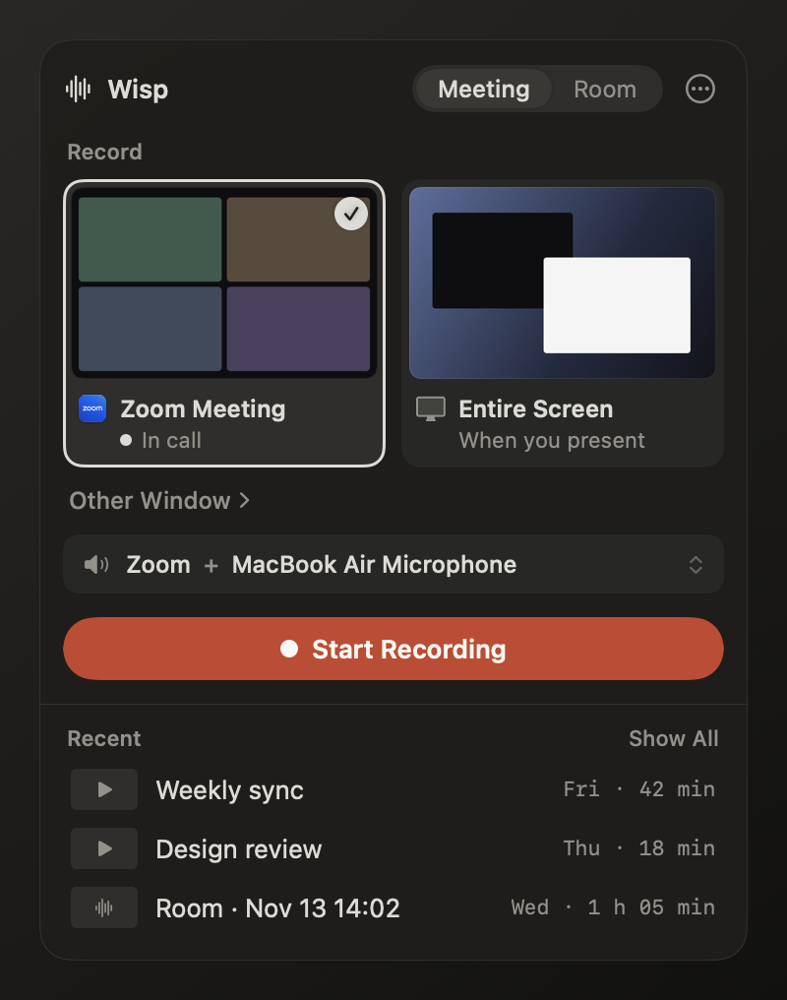
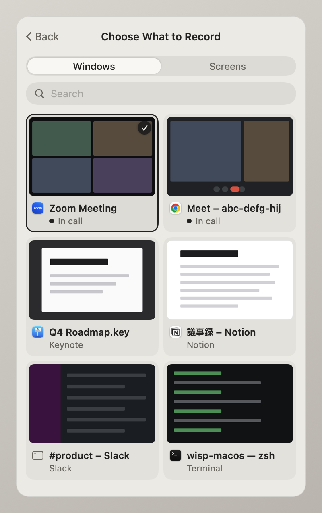
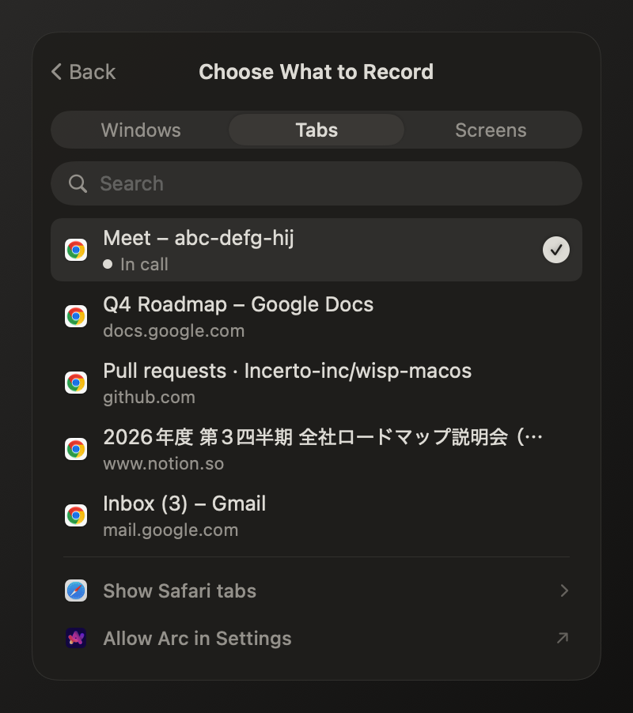
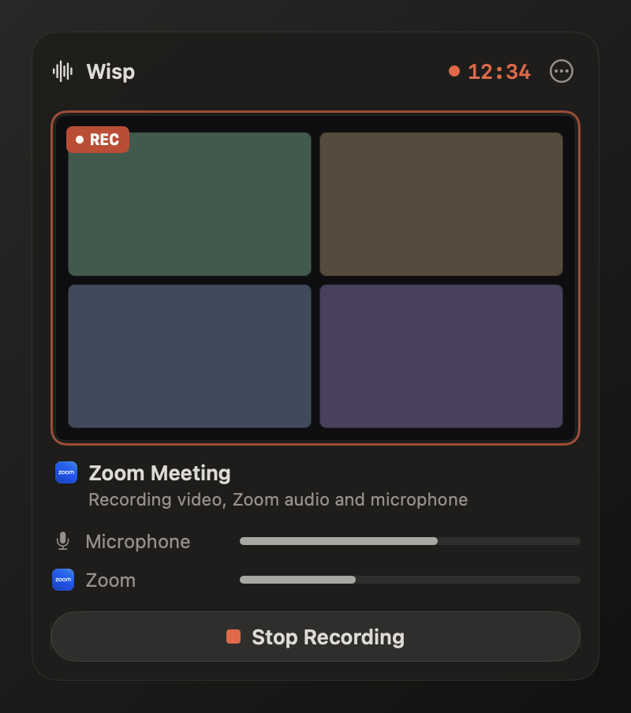

# Wisp

A menu-bar meeting recorder for macOS that keeps everything on your Mac.
An open-source product by [Incerto](https://www.incerto.tech/), under the Apache License 2.0.

Wisp records **one window, one display or one browser tab** as video, and saves your
**microphone** and the **system audio** (the other people in the call) as two separate audio
tracks next to it. Nothing is mixed, so you can play, edit or transcribe each side on its own.

<p>
  
  
  
  
</p>

## What it does

- **Picks the meeting for you.** Open the panel during a Zoom, Microsoft Teams, Google Meet or
  Webex call and the meeting window is already selected, with "Entire Screen" next to it for
  when you present. **Other Window ›** shows every recordable window and display as
  thumbnails, in the same panel.
- **Records a browser tab.** Pick a single tab in Google Chrome, Microsoft Edge, Brave,
  Vivaldi, Chromium (and Chrome's and Edge's beta channels), Arc, Dia or Safari. The video
  shows the tab's window while that tab is the one on screen, and holds a frame from just
  before you switched away while you look at another tab (at most a glimpse of the other tab
  can slip in first). If the tab is in the background when you start, Wisp brings it to the
  front of its window (Dia also brings that window forward), and it follows the tab if you
  drag it into another window (except in Safari, which has no tab ids: there a tab is its
  window and position). Meetings running in a background tab (Meet, Zoom, Teams or Webex on
  the web) are recognised from the tab's address.
- **Keeps audio separate from video.** The system-audio track records the meeting app (or
  every app) no matter what the video shows, so you can show your slides and still record the
  other side. Change the audio source from the audio row.
- **Room mode.** Microphone only, no screen: leave the laptop in a meeting room.
- **Shows what is being recorded.** A thin vermilion frame surrounds the recorded window or
  display. The frame itself never appears in the recording or in other apps' screen sharing.
- **Keyboard first.** Return starts, ⌘. stops, Esc goes back or closes the panel, arrow keys
  move the selection and ⌘F searches.

### Where recordings go

```
~/Movies/Wisp-macos/
  index.json                  list of recordings (title, time, status)
  <id>/video.mov              the window, display or tab
  <id>/mic.m4a                your microphone
  <id>/system.m4a             the meeting app (or every app)
  ambient/<id>/mic.m4a        Room recordings
```

All tracks share one start time, so they line up when played together. Files are written in
10-second fragments: if the Mac crashes or loses power mid-meeting, everything up to the last
fragment still plays, and the recording shows as "Interrupted".

## Privacy

- **Wisp makes no network requests.** It has no analytics, no update check and no account.
  Recordings and the recordings list stay in `~/Movies/Wisp-macos` on your Mac.
- The only link that leaves the app is **Having trouble? Read the guide**, which opens
  [the permissions guide](docs/permissions-howto.md) in your browser.
- Meeting detection runs on your Mac and looks only at app identifiers, window titles and,
  for tabs, the tab's title and address.
- To list tabs, Wisp asks each browser for its windows, tab titles and addresses through
  macOS Automation (it runs the browser's own scripting interface locally, through
  `osascript`). It never launches a browser that is not running. Private and incognito windows are skipped in Chrome-family browsers and Arc; Safari and Dia do not tell scripts which windows are private, so tabs in their private windows can appear in the list (they are never recorded unless you pick one).
- Recording laws differ between countries and regions, and many require everyone's consent.
  Tell the people you record.

## Requirements

- macOS 14 Sonoma or later. Day-to-day testing so far has been on macOS 27 on Apple silicon.
- Xcode 16.4 or later (Swift 6) to build. There are no third-party dependencies.

## Build and run

There are no downloadable builds yet; build from source.

```bash
git clone https://github.com/Incerto-inc/wisp-macos.git
cd wisp-macos
swift build                    # debug build of every target
swift test                     # unit tests (no permissions or display needed)
./Scripts/package-app.sh       # build Wisp.app and install it in /Applications
open /Applications/Wisp.app
```

`Scripts/package-app.sh` builds a release binary, wraps it as `.build/Wisp.app`, signs it and
copies it to `/Applications/Wisp.app`.

- It stops without changing anything if `/Applications/Wisp.app` is a different app.
- If Wisp is running, it asks you to quit it first (quitting mid-recording would ruin the
  files) and never quits it for you.
- `WISP_SKIP_APPLICATIONS_INSTALL=1 ./Scripts/package-app.sh` builds and signs
  `.build/Wisp.app` only.
- It signs with the first "Apple Development" certificate in your keychain, or ad-hoc when
  there is none. `WISP_CODESIGN_IDENTITY` picks another one. With an ad-hoc signature macOS
  forgets Wisp's permissions on every rebuild, so you will be asked again each time.

Run Wisp from the `.app`. With `swift run Wisp` the permissions go to your terminal instead.

## Permissions

| Permission | Needed for | Asked |
| --- | --- | --- |
| Screen & System Audio Recording | Meeting recordings: video and system audio | Once. Reopen Wisp after allowing it. |
| Microphone | Meeting and Room recordings | Once |
| Automation, per browser (optional) | Listing and recording browser tabs | Once per browser |

The panel shows what is missing and walks you through it. Without Automation, Wisp lists
windows and displays but not tabs. If something does not work, see
[docs/permissions-howto.md](docs/permissions-howto.md).

## Limitations

- **Windows on another desktop (Space) may freeze.** Wisp lists them (marked
  "Other Desktop"), but some apps stop drawing while they are hidden, so the video can stop
  until you switch back. Audio keeps recording.
- **Tab audio is app-wide.** macOS captures sound per app, never per tab. When the meeting is
  in a browser tab, Wisp records every app's sound by default, so other tabs and apps that
  play sound end up in `system.m4a` too.
- **A hidden tab holds its last frame.** The video shows the recorded tab only while it is the
  tab on screen in its window. The video also shows the whole browser window, including the
  toolbar, not just the page.
- **Firefox tabs are not supported.** Firefox windows can still be recorded as windows.
- One recording at a time. The microphone is the system's input device; change it in
  System Settings → Sound.

## Project status and roadmap

Wisp is early (version 0.1). Recording works and is used daily on one setup; expect rough
edges on other Macs, and please report them.

Next:

- **Transcription**, later. The separate tracks are there so that "me" (`mic.m4a`) and
  "everyone else" (`system.m4a`) can be transcribed apart. It is not in the app yet; when it
  lands, this README will say exactly what, if anything, leaves your Mac.
- Signed and notarized downloads, so that building from source becomes optional.

## For contributors

- [ARCHITECTURE.md](ARCHITECTURE.md): the layers, the ports and how a recording runs.
- [CONTRIBUTING.md](CONTRIBUTING.md): build, test, style and the snapshot tool.
- [SECURITY.md](SECURITY.md): how to report a vulnerability privately.
- [Room mode](docs/ambient-mode.md) and the [permissions guide](docs/permissions-howto.md).

## About

Wisp is made by [Incerto](https://www.incerto.tech/), which builds AI and brings it into
hospitals and companies. We made Wisp for our own meetings: separate tracks make transcripts
and speaker separation far easier to hand to AI tools. It is open source so that anyone can
check what it records and where that goes.

The website is in [`site/`](site/), in English and Japanese.

## License

Wisp is licensed under the [Apache License 2.0](LICENSE). The Incerto name, the Incerto swan
mark and the Wisp app icon are Incerto's trademarks and artwork and are not covered by that
license; see [NOTICE](NOTICE). If you fork Wisp, give it your own name and icon.
